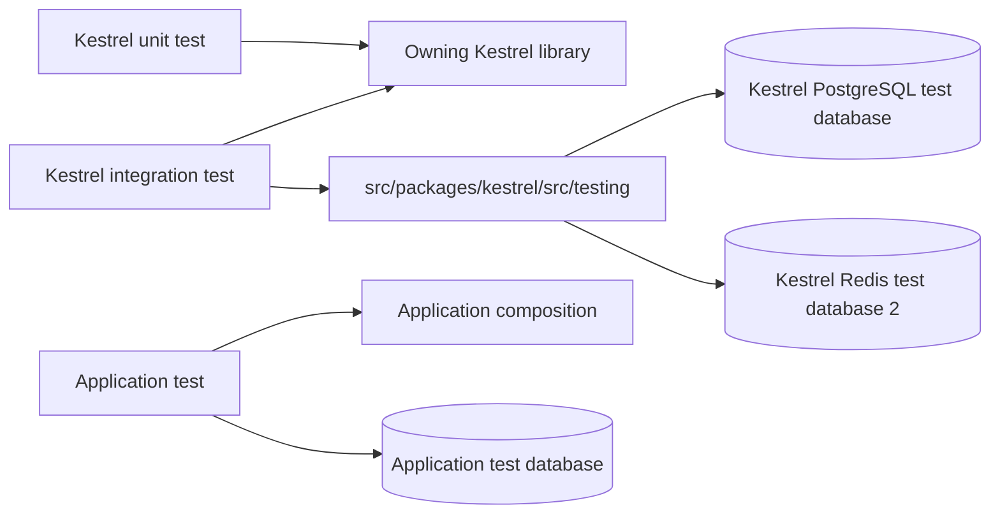
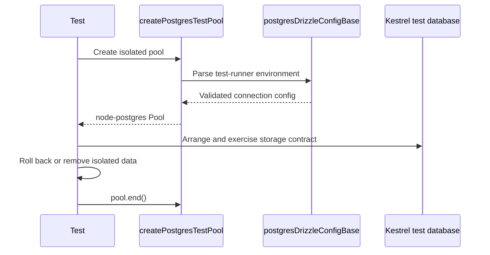

# Testing

[Documentation](../README.md) · [Implementation index](./README.md) · [Usage guide](../usage/testing.md)

Vitest is the default test runner for unit and integration tests.
Playwright may be used later for end-to-end browser tests, but not now.

Fastify HTTP bindings are tested with `fastify.inject()`.

## Concepts and model

Kestrel unit tests exercise one library without application composition. Kestrel integration tests compose only the lower-level Kestrel dependencies they need and use dedicated PostgreSQL or Redis test databases. Application tests remain outside `src/packages/kestrel/src` and verify application policy and composition rather than retesting generic library behavior.



## Usage guide

For application setup and task-oriented examples, see the [Testing usage guide](../usage/testing.md).

## Design and implementation

The helpers stay below `src/packages/kestrel/src/testing` so Kestrel tests never depend on application bootstrap, application schema or application test support. The PostgreSQL helper reuses `postgresDrizzleConfigBase` validation, reads only test-runner connection variables and defaults to the isolated `kestrel_test` database. It does not run migrations or own schema setup beyond the pool it returns.

Tests must remain compatible with Vitest's `--no-isolate` mode. Mutable global state, fake timers, event listeners, dependency overrides and resources must be restored explicitly.

The starter's generated greeting tests exercise the composed application through Fastify injection. Redis variants replace the native `redisDependency` registration before resolving the HTTP runtime, preserving standard provider boot and application disposal without opening a Redis socket. Cleanup asserts one connection and one destruction, and rejects any Redis command use, including errors swallowed by cache fail-open behavior. Real Redis behavior remains covered by the framework integration suites; greeting tests must acquire a storage fixture if the example later uses storage. Atlas selection does not change this isolation.

## Execution scenario



## Public API

| Module export | Purpose |
| --- | --- |
| `createPostgresTestPool()` from `src/packages/kestrel/src/testing/postgres.ts` | Creates a validated pool targeting the Kestrel integration-test database. |
| `createRedisTestContext()` from `src/packages/kestrel/src/testing/redis.ts` | Connects to Redis database 2 and returns a client, unique key prefix and cleanup operation. |
| `testHttpAccess` from `src/packages/kestrel/src/testing/http_access.ts` | Supplies an explicit unrestricted HTTP access policy for Kestrel tests. |

The testing library has no adapter API. Tests use the same public adapter contracts and bundled implementations as production libraries; the helpers only provide isolated test composition.

Local integration tests use dedicated databases inside the same PostgreSQL instance. Application tests use the application-configured test database, while Kestrel tests use the database selected by `KESTREL_TEST_DATABASE`, defaulting to `kestrel_test`; the repository-owned `infra:prepare` command creates the framework test database idempotently, independently of playground initialization. Kestrel-only helpers live in `src/packages/kestrel/src/testing`, keeping Kestrel tests inside the same source boundary. Application runtime test support lives separately in `src/server/tests` and must never be imported by Kestrel code or tests. `createPostgresTestPool()` reads the test runner's `DB_HOST`, `DB_PORT`, `DB_USER`, `DB_PASSWORD`, `DB_SSL` and `KESTREL_TEST_DATABASE` variables and otherwise uses local development defaults.
Transaction rollback isolation is to be used between unit tests using the database.

Specs in the form of comments may help drive the tests, there's an example in [Actions](./actions.md).

## Redis integration tests

Redis integration tests use the existing development Redis service and logical database `2`. The test helper reads only `KESTREL_TEST_REDIS_URL`, defaults to `redis://127.0.0.1:56379/2`, and rejects URLs that do not explicitly select `/2`. Container runs use `redis://redis:6379/2`; the dev-container environment provides it after rebuilding. It deliberately does not fall back to the application's `REDIS_URL`. The framework test client is `@redis/client`, installed as a development dependency after a script-disabled lockfile security preflight.

`createRedisTestContext()` returns `{ client, keyPrefix, dispose }`. Connections and commands have bounded timeouts, with reconnection and offline queuing disabled so unavailable infrastructure fails tests instead of hanging or silently skipping them. The helper installs an error listener and reports asynchronous client failures at cleanup. Every context creates its own UUID-based `kestrel:test:` prefix. All test-created keys must remain under that prefix, including alternate adapter prefixes and manually inserted corrupt entries.

Cleanup scans and unlinks only that context's prefix, then closes its socket and removes its error listener even if cleanup fails. Never use `FLUSHDB` or `FLUSHALL`: other suites and developers can use the same logical database concurrently. Tests do not modify global Redis configuration or select application databases. An interrupted process can leave keys behind; their random prefixes prevent collisions, but automatic stale-test cleanup remains a possible future addition.

```sh
npm run test:ai -- src/packages/kestrel/src/cache/adapters/redis src/packages/kestrel/src/testing/redis.test.ts
```

The cache adapter suite checks that Redis reports `db=2`, validates the absolute TTL with `PEXPIRETIME`, and polls the physical key until native expiration removes it. Those TTL checks use real time because fake timers cannot advance the Redis server clock. Separate unit tests use injected transports for controlled failure paths. Missing infrastructure is a test failure, not an automatic skip.

<a id="mutation-testing-pilot"></a>

## Framework mutation testing

The [lot inventory](./mutation_testing_inventory.md) records assessment and review states for every component, with selected-slice evidence kept separate from full-component coverage. Its [JSON catalog](./mutation_testing_inventory.json) is audited against the actual Stryker scope by `npm run check:mutation-inventory`. All named profiles enforce ten minutes of mutation work per execution, including baseline tests; checkpointing and cleanup follow the deadline. The full/custom command is intentionally unchanged.

The bounded `test:mutation:shutdown` profile assesses only the application stop/disposal/error-collection methods with all related tests and static mutants retained. Like the static sample, it enforces ten minutes of mutation work before checkpointing and cleaning owned resources. Its cache and reports live separately under `artifacts/mutation/shutdown/`. See the [shutdown before/after assessment](./mutation_testing_framework.md#bounded-application-shutdown-comparison).

The bounded `test:mutation:authentication-sessions` profile selects the entire `authentication/manager.ts` file, including proof completion, resolution, revocation and private validation/renewal helpers. It retains static mutants, selects related framework tests and uses the same ten-minute deadline and owned-resource cleanup. Reports and cache live under `artifacts/mutation/authentication-sessions/`. This is selected evidence inside authentication, not an assessment of its adapters, password mechanisms or HTTP integration. See the [account/session comparison](./mutation_testing_framework.md#authentication-account-and-session-review).

Focused `authorization-decisions`, `password-verification`, `postgres-ownership`, `throttling-inspection` and `lock-renewal` profiles also retain static mutations and enforce the ten-minute budget. `focusedPatterns()` freezes whole-file or anchored method/function selections; the contributor guide records their exact scopes. Their reports/caches remain independent, and deadline tests exercise interruption and cleanup for each profile. These selected lots do not establish whole-component coverage.

The `actions-crud-pagination`, `cache-pruning`, `execution-diagnostics` and `catalog-identities` profiles extend the same bounded selection/report lifecycle. Each has a fixed declaration in `focusedPatterns`; start-only function selections explicitly reach EOF. Deadline and configuration tests cover every named profile. Their selected scopes can overlap a later full-component assessment, so their counters must not be added together. The [CRUD, pagination and follow-up assessment](./mutation_testing_actions_followup.md) records their evidence and limitations.

The other profiles share the same runner and store-isolation lifecycle: `test:mutation:fast` sets `ignoreStatic: true`, `test:mutation:component -- <name>` retains static mutants within one component, and `test:mutation:static-sample` selects anchored import-time expressions across authentication, throttling and PostgreSQL configuration. Each profile owns separate report/cache paths. The sample wrapper enforces a ten-minute mutation budget with graceful checkpointing followed by process-group termination if needed; resource cleanup follows the deadline. Tests verify profile scope, cache separation, static policy and deadline cleanup. See the [contributor commands](../contributing/mutation-testing.md#run-framework-mutation-testing) and [bounded measurement](./mutation_testing_framework.md#bounded-static-sample).

`npm run test:mutation` runs StrykerJS 10.1.1 through its Vitest runner over all TypeScript and TSX runtime sources under `src/packages/kestrel/src`. The scope includes every component directory, browser client code exercised through Node-compatible and React server-rendering tests, adapter implementations, schemas, configuration declarations and index modules. Source files containing only types or re-exports can naturally produce no mutations. Framework test modules, `.d.ts` declarations, the exact repository infrastructure helpers `testing/postgres.ts` and `testing/redis.ts`, and the shared conformance test assertions under `workers/testing/` are excluded from mutation. Those helpers remain available to tests in the sandbox. The public `testing/http_access.ts` module remains in scope.

`vitest.mutation.config.ts` discovers every framework `*.test.ts` and `*.test.tsx` file, including PostgreSQL and Redis integration suites, while excluding application, documentation and generator tests by its framework-only discovery root. It uses one non-isolated project and the `forks` pool to retain the module cache between files. `scripts/testing/coverage-runner.mjs` snapshots each completed file's Stryker metadata after its `afterAll` hooks and resets only the shared coverage object's per-test map. Instrumented functions capture that object, so replacing its identity would silently lose coverage from cached modules. Detaching metadata bounds its lifetime without paying for a runner per file or small project. The regression probe compares real isolated and cached-module Stryker runs, including static activation, semantic covering-test identities and recovery after import errors. Run `npm run test:mutation:infrastructure` after upgrading Stryker or Vitest because this optimization depends on their metadata protocol. The ordinary `test:ai` command still checks full `--no-isolate` compatibility, so tests must restore owned state and resources. The separate root Vitest unit/integration configuration remains unchanged.

`vitest.related: true` lets Vitest select framework suites from the static and dynamic import graph. This avoids rerunning unrelated suites for each static mutant; runtime mutants additionally use Stryker's per-test coverage filtering. The configuration adds the absolute CLI entrypoint path to `forceRerunTriggers`, because the CLI subprocess tests have graph-opaque dependencies. When the complete source scope includes that entrypoint, all 1,633 baseline tests still run. Targeted scopes use the dependent suites and may omit graph-opaque subprocess tests; a complete baseline count does not remove the subprocess coverage limitation described below.

The default mutation command and `npm run test:mutation:dry-run` require the dedicated test services. Prepare them with `npm run infra:up` and `npm run infra:prepare`, using the connection settings documented above. A missing or unavailable store is a failure, not an automatic skip. The npm commands invoke an infrastructure wrapper that allocates a unique run identifier. Each of the two Stryker workers provisions its own `kestrel_test_mutation_<run>_<worker>` PostgreSQL database through the maintenance database; restarted workers receive new identities. This isolates fixed schema names and database-scoped advisory locks. Redis contexts continue to use database 2 and independent UUID prefixes. The PostgreSQL role needs permission to create and drop these temporary databases.

The wrapper records exact database ownership in a temporary manifest before creation and removes only those databases when Stryker and its owned process group have stopped. It refuses to adopt an existing unowned database and never resets the ordinary framework or application database. Cleanup failure preserves the manifest location for recovery. Use the npm commands so this lifecycle encloses both normal runs and interruptions. An immutable setup guard also checks effective PostgreSQL host, port, user and database before connecting; a mutated provider that discards connection settings is rejected instead of falling back to ambient `pg` defaults. These administrative and routing helpers are outside the mutation scope.

An outgoing Redis guard checks physical keys, Lua key declarations and scan patterns against the test UUID namespace before driver queuing. It rejects mutated prefixes without rewriting commands or affecting fake unit-test clients. Review guard-related detections separately from framework assertion failures. The wrapper currently requires POSIX process groups (Linux/macOS); Windows process-tree cleanup remains deferred.

Reports are written under `artifacts/mutation`, and the temporary `.stryker-tmp` sandbox is ignored by Git. Generated distributions, assets and reports are excluded from sandbox copying. No dashboard reporter or remote report publication is configured. Static mutants remain included, no mutation operator categories or individual survivors are suppressed, and no TypeScript checker is enabled. The normal build remains a separate validation of TypeScript contracts.

The single `import.meta.glob()` call in Studio's client extension loader has a local Stryker disable/restore region because Vite must parse literal patterns and options before execution; Stryker's conditional instrumentation would otherwise make even the baseline fail to compile. The exclusion covers that compile-time declaration only. The containing component, registry construction and asynchronous renderer loading remain in scope, and the reason is recorded beside the source.

The mutation score is informational: `thresholds.break: null` disables the score gate. Setup failures and failures in the initial unmodified test run still fail the command. There is no new CI job and no change to `test:ai`. The default command performs a fresh assessment; `--incremental` is an explicit local optimization. Force a fresh assessment after configuration, dependency, environment or non-mutated helper changes, which the incremental cache does not fully track. See the [contributor instructions](../contributing/mutation-testing.md#run-framework-mutation-testing).

The [framework assessment](./mutation_testing_framework.md) records execution constraints and prioritized regression scenarios while the full campaign is in progress. The [historical pilot analysis](./mutation_testing_pilot.md) records the adapter/circuit-only baseline, assertions, survivor review and the former 88% floor. Those pilot scores and classifications do not establish a baseline for the expanded framework scope, and that floor is no longer enabled.

Scope does not imply complete mutation coverage: some CLI and Vite runtime tests execute child Node processes, whose coverage is not collected in the Vitest worker's Stryker globals. Those sources remain included and may report `NoCoverage`; assessing subprocess instrumentation is deferred rather than hiding the components from the report.

The framework-wide dry run on November 9, 2026 instrumented 631 source files across 34 component directories, generated 42,816 mutations, and passed all 1,633 framework tests from the 244-file test collection. The metadata-snapshot runner completed its local initial test run in about 19 seconds, compared with about 48 seconds for bounded projects of six files and about 71 seconds with per-file isolation. These timings are local observations rather than a controlled performance benchmark. The dry run validates instrumentation and the unmodified tests, not a complete mutation score: none of those individual mutations are activated by the dry-run command.

A separate earlier active-mutation check targeted `utils/catalog.ts` and Studio's `observation_content.tsx` with their two test files selected explicitly through `--testFiles`: all four mutations were killed by five tests in two seconds. The HTML/JSON reports from that check describe its small scope, not the full framework. An ignored local control configuration used unrelated tests for `studio/client/src/runtime_config.ts`; its 17 survivors produced a 0% score and exit code 0, confirming that the removed score gate is no longer constraining execution. That control report is retained separately as `artifacts/mutation/score-gate-check.json`. Neither targeted result is a framework-wide quality baseline.

`npm run build:ai` and framework typecheck passed. The ordinary `npm run test:ai` also passed all 1,655 tests in 249 files with isolation disabled, independently of Stryker's bounded-project execution.

## Specific rules

Here are some specific rules gathered over time:

- Don't test configuration files

The repository Compose services use dedicated host ports 55432 (PostgreSQL) and 56379 (Redis). See [infrastructure setup](../contributing.md#integration-test-infrastructure). PostgreSQL and Redis helpers are repository test infrastructure and are excluded from the runtime archive; the HTTP policy fixture has an explicit testing subpath.


### Additional Redis adapter suites

Locks, throttling, tokens and authentication sessions use the same `createRedisTestContext()` fixture as the cache, dedicated database 2, unique per-test prefixes and deterministic resource disposal. Their suites are explicitly assigned to the integration project in `vitest.config.ts` and run through `npm run test:ai`. Redis must be 7.4+ for session hash-field expiration; the development service uses Redis 8. Tests cover independent clients, concurrent ownership/consumption, atomic batches, fencing precision, actual-cost debt, lease returns, retained token pruning, session index expiration and Fastify-injected authentication with Redis sessions. Unit suites cover adapter selection, minimal boot, optional pruning, scoped composition and cleanup failures without starting HTTP listeners.
